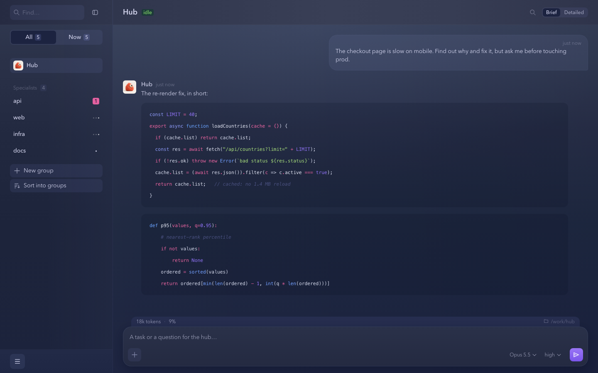

# Hyperspace — a theme for Agents Hub

A dark purple theme for the hub page: gradients on the background, the sidebar and the buttons, a dark header and
footer, its own hub icons and pictures instead of the agents' emoji (🎨, 🧑‍💻, 🧪), and colors for "Flow".

Install: "Settings" → "Plugins" → search for "hyperspace" (or tell the hub: "install the hyperspace plugin"), then pick
it in "Settings" → "Theme" → Hyperspace.

## What is in the plugin

- `hyperspace.json` — the theme itself. `colors`, `icons`, `avatars` — as in any hub theme. On top of them, for the
  plugin's code:
  - `gradients` — the fill of the surfaces `page`, `sidebar`, `header`, `footer`, `primary`: a gradient
    `{"colors": ["#…", "#…"], "angle": 180}` (colors spread evenly) or a plain color;
  - `flow` — the colors of "Flow": `msg`, `task`, `result`;
  - `iconColors` — the color of icons and avatars: `icons`, `avatars`, or one by one — by icon name (`send`, `clock`…)
    or by emoji (`"🎨": "#a77bec"`). The pictures in `i/` and `a/` are shapes only; the color comes from here.
- `main.js` and `hyperspace.css` — apply `gradients`, `flow` and `iconColors` of the selected theme. They work for any
  theme with these blocks: you can take the plugin as a base for your own theme.

An agent's emoji without a picture in `avatars` stays an emoji.

## Clean in Hyperspace colors

The plugin can dress the dark Clean theme in Hyperspace: colors and fonts, a seamless window (panels edge to edge,
no gaps or rounded corners, one shared title bar), a purple accent, code highlighting as in the editor. The page
layout stays Clean's.

To turn it on, choose the **dark** Clean in "Settings" → "Theme" (Clean is built into the hub).

Nothing else to turn on: `clean-hyperspace.css` loads with the plugin, but all its rules apply only under the dark
Clean (`html.th-clean.th-clean-dark`) — without it, in the light Clean and in any other theme, including Hyperspace
itself, the page does not change.

